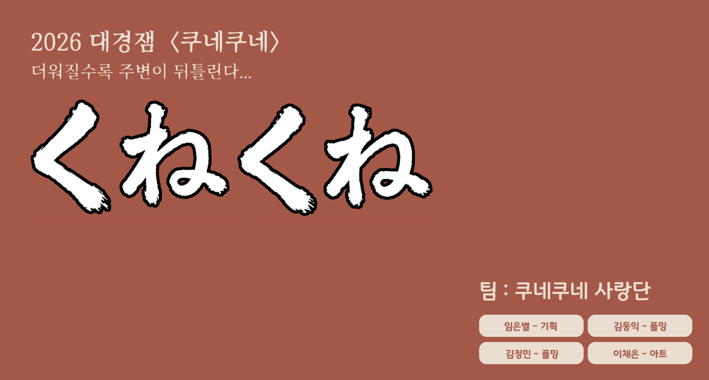
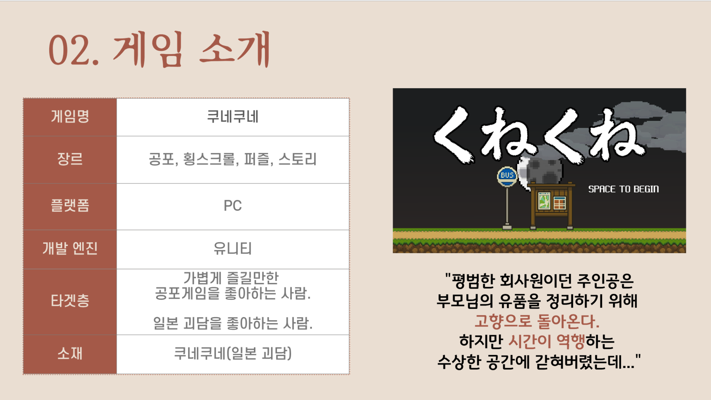
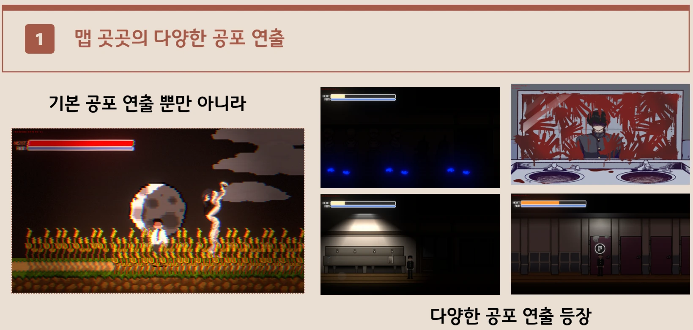
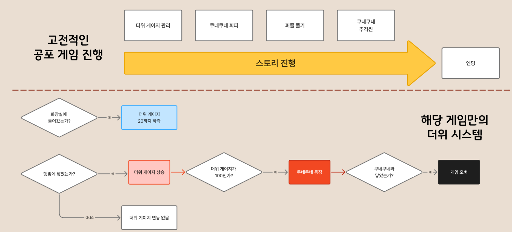

<div align="center">



# 🌾 쿠네쿠네 (くねくね)

**더워질수록 주변이 뒤틀린다...**

2026 대경잼 출품작 · 팀 **쿠네쿠네 사랑단**


</div>

---

## 📖 스토리



> 평범한 회사원이던 주인공은 부모님의 유품을 정리하기 위해 **고향으로 돌아온다.**
> 하지만 **시간이 역행**하는 수상한 공간에 갇혀버렸는데...

---

## 🎮 게임 소개

| 항목 | 내용 |
|:---:|:---|
| **게임명** | 쿠네쿠네 (くねくね) |
| **장르** | 공포, 횡스크롤, 퍼즐, 스토리 |
| **플랫폼** | PC |
| **개발 엔진** | Unity 6 (6000.3.19f1) · URP 2D |
| **타겟층** | 가볍게 즐길 만한 공포 게임을 좋아하는 사람<br>일본 괴담을 좋아하는 사람 |
| **소재** | 쿠네쿠네 (일본 괴담) |

---

## ✨ 주요 특징

### 1️⃣ 맵 곳곳의 다양한 공포 연출



- 글리치, 화면 왜곡, 붉은 텍스트 같은 **기본 공포 연출**
- 학교 화장실, 미술실, 복도, 고향집 등 **장소마다 다른 이벤트와 컷신**
- Timeline 기반 컷신과 레터박스·대사 연출

### 2️⃣ 이 게임만의 **더위(Heat) 시스템**



흔한 공포 게임처럼 스토리를 따라가면서, **더위 게이지**를 관리해야 살아남을 수 있습니다.

| 조건 | 결과 |
|:---|:---|
| ☀️ 햇빛에 닿음 | 더위 게이지 상승 |
| 🌳 햇빛을 피함 | 더위 게이지 변동 없음 |
| 🚻 화장실에 들어감 | 더위 게이지가 **20**까지 떨어짐 |
| 🔥 더위 게이지 **100** 도달 | **쿠네쿠네 등장** |
| 💀 쿠네쿠네와 닿음 | **게임 오버** |

- 시간이 거꾸로 흐르면 주인공이 **어른 → 학생 → 아이**로 어려지고, 나이가 어릴수록 더위가 빨리 오릅니다.
- 게이지가 가득 차 있으면 스태미나 회복이 느려집니다.

### 3️⃣ 퍼즐과 추격

- 🧩 **퍼즐**: 석고상 퍼즐, 인형 조립, 비밀번호 자물쇠 등
- 🏃 **추격**: 진흙, 허수아비, 매달린 밧줄 같은 장애물을 피해 쿠네쿠네에게서 도망치기
- 🎒 인벤토리, 퀘스트, 세이브 시스템

---

## ⌨️ 조작법

| 키 | 동작 |
|:---:|:---|
| `A` `D` / `←` `→` | 이동 |
| `Shift` | 달리기 |
| `E` | 상호작용 |
| `Space` | 게임 시작 |
| `Esc` | 일시정지 |

---

## 🗂️ 프로젝트 구조

```
Assets/Scripts
├── Animation      # 애니메이션 트리거
├── Camera         # 카메라 및 조명 이벤트
├── Chase          # 추격 장애물 (진흙, 허수아비, 밧줄)
├── Core           # 챕터, 게임 시작, 조작 잠금
├── Dialog         # 대사 시스템
├── Effect         # 연출 효과
├── Interaction    # 상호작용 오브젝트 (학교, 집, 야외)
├── Item           # 아이템 및 인벤토리
├── KuneKune       # 쿠네쿠네 AI
├── Map            # 맵 전환, 글리치, 패럴랙스, 햇빛 영역
├── Player         # 이동, 더위 시스템, 나이 프로필
├── Quest          # 퀘스트
├── Save System    # 저장 및 불러오기
├── Sound          # 사운드 및 더위 오디오 효과
├── Timeline       # 컷신, 커스텀 트랙 (Dialog, Letterbox)
└── UI             # HUD, 인벤토리, 퍼즐 UI, 일시정지 메뉴
```

---

## 🚀 실행 방법

1. 저장소를 클론합니다.
   ```bash
   git clone https://github.com/bbabang7709/KuneKune.git
   ```
2. **Unity Hub**에서 **Unity 6000.3.19f1**로 프로젝트를 엽니다.
3. `Assets/Scenes/Scene_Intro.unity` 씬을 열고 ▶ Play를 누릅니다.

---

## 👥 팀 쿠네쿠네 사랑단

| 이름 | 역할 |
|:---:|:---:|
| 임은별 | 기획 |
| 김동익 | 프로그래밍 |
| 김정민 | 프로그래밍 |
| 이채은 | 아트 |

---

## 📄 License

이 프로젝트는 [LICENSE](LICENSE) 파일의 조건을 따릅니다.
